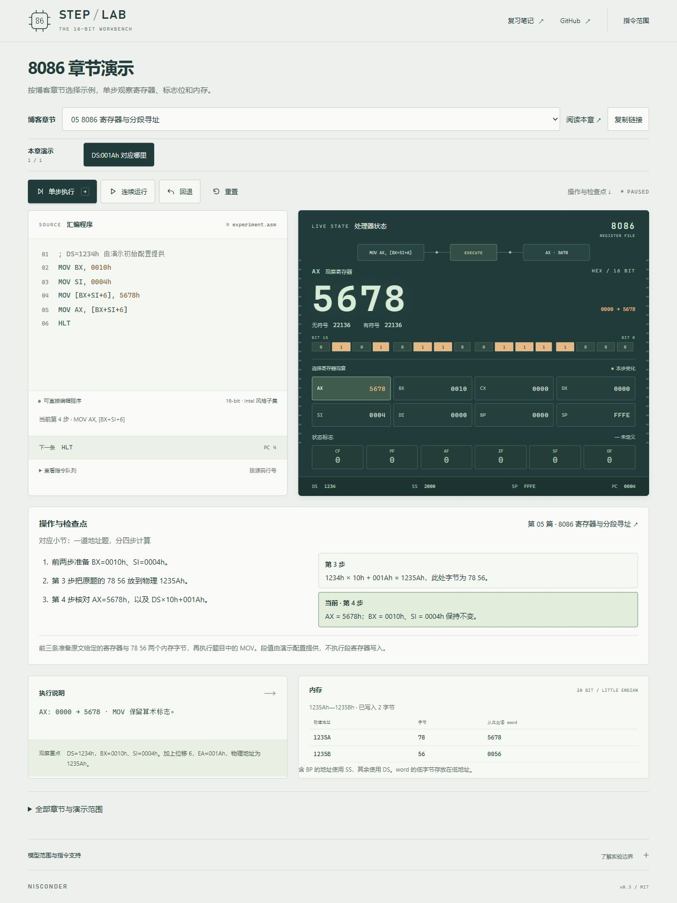

# 8086 Step Lab

与 [ICS / 8086 复习笔记](https://nisconder.pages.dev/series/ics-8086/) 配套的章节演示。9 篇正文、15 个可编辑示例，逐条观察寄存器、标志位、内存与调用栈。程序在浏览器内运行，无第三方依赖。

**[打开在线实验室](https://nisconder.github.io/8086-step-lab/)**



## 使用

安装 Node.js 20 或更高版本，然后运行：

```sh
node server.mjs
```

打开 <http://localhost:8086>。无需 `npm install`。也可以将 HTML、CSS 与五个浏览器模块部署到任意静态托管服务；ES modules 需要 HTTP 服务，不能直接双击 HTML。

- **章节**：选择博客章节，再选择本章演示。“阅读本章”打开对应文章；“复制链接”分享当前章节和示例，不包含自定义代码。
- **操作与检查点**：查看对应小节、三步操作和预期结果。点击检查点会执行到指定步数，也能跳回较早步骤。编辑代码后检查点停用，重新选择原示例可恢复。
- **单步**：执行一条指令，暖铜色标记本步变化，并短暂点亮指令到结果的 SVG 通路。单步按钮聚焦或焦点在非输入区域时可按右方向键。
- **观察寄存器**：点击 AX/BX 等寄存器，切换大号十六进制读数、有符号与无符号十进制解释，以及按 15→0 排列的二进制灯带。SVG 通路始终显示实际指令目标，与选择观察的寄存器分开。
- **连续运行 / 暂停**：每 180ms 执行一步；Esc 暂停；单轮上限 1,000 步。
- **回退**：恢复上一份完整寄存器、标志、内存与执行位置快照。最多保留 256 步。
- **重置**：重新编译当前代码，从初始状态执行。修改代码后下一次运行也会重新开始。

界面采用微处理器实验台的视觉：浅色代码编辑区、深青处理器面板、薄荷读数与暖铜变化标记。代码提供行号与语法高亮；手机端优先显示读数，控制条随滚动保留。减少动态效果设置下关闭信号动画与过渡。

## 章节演示

每个示例注明对应正文小节、操作步骤、检查点，以及与原题不同的改写。

| 博客章节 | 可操作内容 |
| --- | --- |
| [01 计算机系统与程序执行](https://nisconder.github.io/8086-step-lab/?chapter=01) | 7 + 5 的读取、相加与写回 |
| [02 进制转换 字符编码与字节序](https://nisconder.github.io/8086-step-lab/?chapter=02) | 32 位对象的小端布局、位掩码、重叠读字 |
| [03 补码 溢出与类型转换](https://nisconder.github.io/8086-step-lab/?chapter=03) | 16 位溢出、零扩展与符号扩展结果 |
| [05 8086 寄存器与分段寻址](https://nisconder.github.io/8086-step-lab/?chapter=05) | DS=1234h，计算 1235Ah 并读取 5678h |
| [06 8086 寻址与数据传送](https://nisconder.github.io/8086-step-lab/?chapter=06) | BP 默认使用 SS、两次入栈与出栈 |
| [07 算术逻辑指令与标志位](https://nisconder.github.io/8086-step-lab/?chapter=07) | INC / DEC 保留 CF、CMP 更新标志 |
| [08 控制转移 子程序与串操作](https://nisconder.github.io/8086-step-lab/?chapter=08) | 近调用、返回位置与保存寄存器 |
| [09 MASM 程序结构与分支循环编程](https://nisconder.github.io/8086-step-lab/?chapter=09) | 数组 1、2、3、4 求和，累减计数循环 |
| [10 DEBUG 调试与汇编实验](https://nisconder.github.io/8086-step-lab/?chapter=10) | 0123h + 0025h，结果写回内存 |

第 04 篇浮点、第 11–16 篇 IA-32 / ELF / 链接装载，以及导读和速查保留为阅读入口，页面明确说明尚未实现的内容。

链接支持 `?chapter=06`、`?chapter=06&demo=stack-order`；单独的 `?demo=stack-order` 会定位所属章节，也兼容旧 `?example=overflow`。浏览器前进、后退可恢复选择。

## 模型范围

支持 `MOV ADD SUB CMP INC DEC AND OR XOR JMP JZ JNZ JC JNC JO JNO PUSH POP CALL RET NOP HLT`。

支持八个 16 位通用寄存器 AX/BX/CX/DX/SI/DI/BP/SP；十进制、`0x2A`、`2Ah`、`101b` 和负立即数；标签与分号注释。内存为 word 操作；有效地址支持 BX/BP、SI/DI 及 8086 合法组合与位移。含 BP 默认使用 SS，其余使用 DS。默认 DS=1000h、SS=2000h、SP=FFFEh，其他寄存器及标志初值为 0；部分章节配置不同的 DS/SS，界面实时显示，重置后恢复本演示配置。未写入的字节按 0 读取。

CF/OF/AF/ZF/SF/PF 根据 16 位结果计算；PF 只检查低字节；INC/DEC 保留 CF；逻辑运算后 AF 未定义，界面显示 `—`。原始 8086 的 `PUSH SP` 保存递减后的 SP。内存用小端字节存储，物理地址按 20 位截断。

**这是指令级教学模型。** PC 与 CALL 压栈的返回位置使用解析后的指令索引，不能当作机器码字节地址或真实 IP。程序不编码机器指令、不模拟时钟、预取队列、DOS/BIOS、中断或 8 位操作，不接受完整 MASM 文件。所有内存操作均有 16 位宽度，省略真实汇编中可能需要的 `WORD PTR`。DS/SS 为模型配置，不作为可写操作数。

## 验证

```sh
node --test
```

测试执行全部 15 个示例，独立核对 43 个检查点的寄存器、标志和内存结果，并检查章节映射、分享链接和异常参数。核心测试以独立有符号/无符号边界计算核对 432 组 ADD/SUB/CMP 结果及六个标志，另检查段默认值、地址回绕、小端重叠读取、8086 PUSH SP、POP SP、条件跳转、不可变历史及输入错误。测试只针对本文声明的模型范围。

语义参考：Intel《[The 8086 Family User's Manual, October 1979](https://www.bitsavers.org/components/intel/8086/9800722-03_The_8086_Family_Users_Manual_Oct79.pdf)》的指令说明与状态标志章节。示例和界面为原创，不附带教材、固件或第三方模拟器。

## 结构

- `core.mjs`：纯函数解析器与执行模型，可被 Node 和浏览器共同使用。
- `examples.mjs`：示例与预期观察点。
- `chapters.mjs`：博客标题、文章链接与演示映射。
- `routing.mjs`：章节链接解析与生成。
- `app.mjs`、`index.html`、`style.css`：无框架交互界面。
- `test/*.test.mjs`：核心、章节与链接的 Node 内置测试，不下载依赖。
- `.github/workflows/pages.yml`：测试通过后发布静态页面。

MIT © 2026 Nisconder
